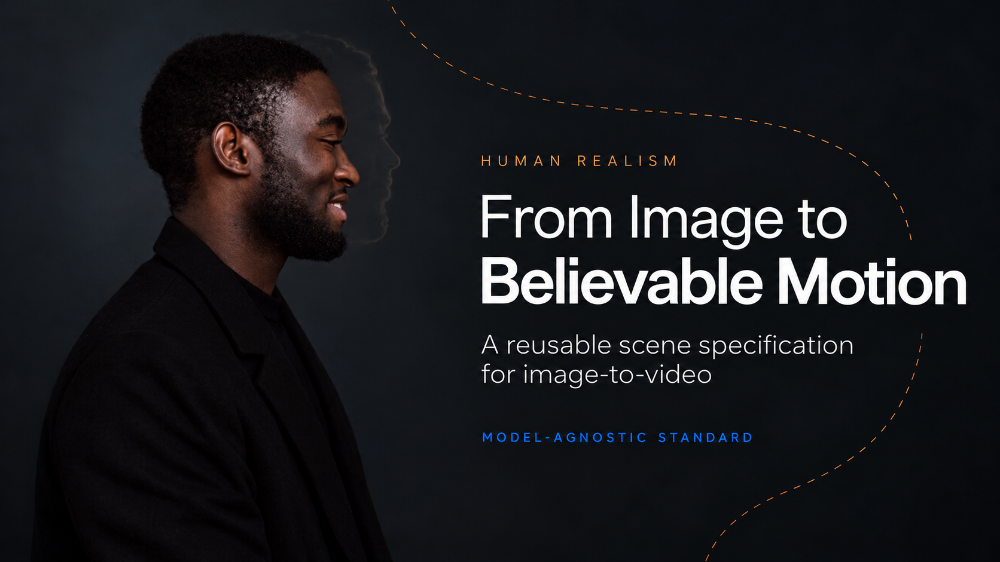
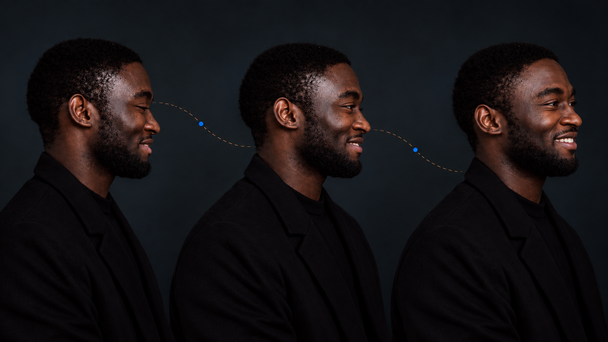
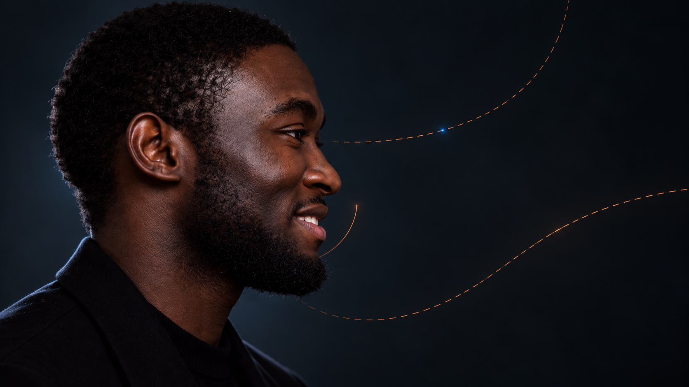
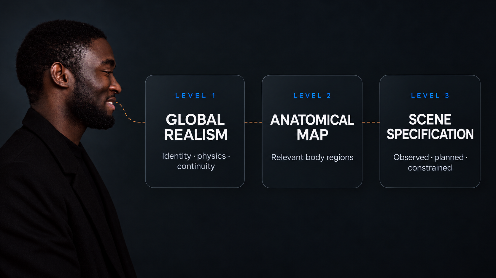
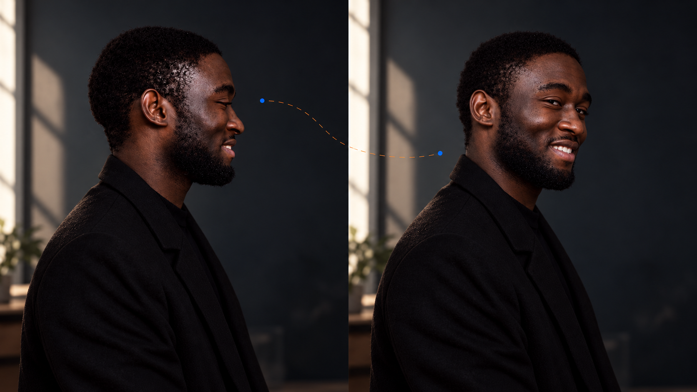
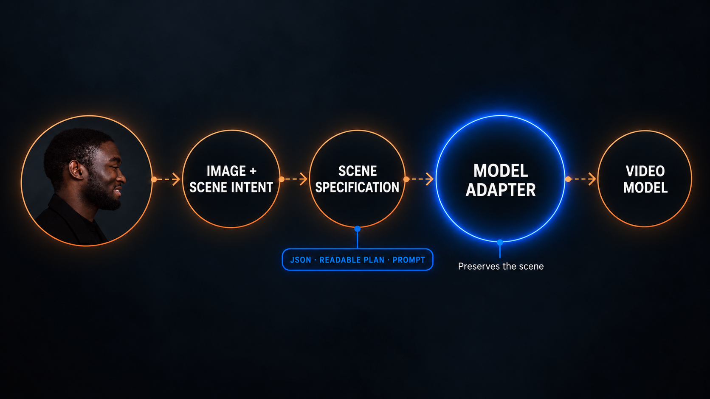
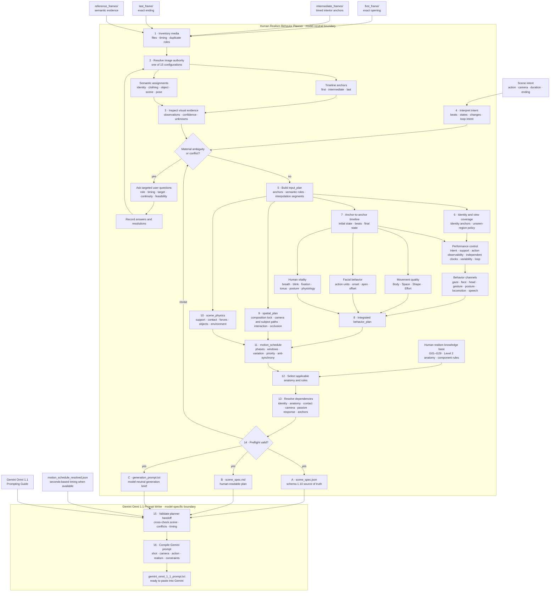
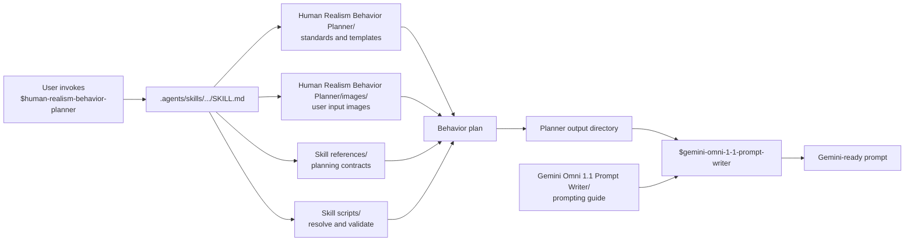

# From Image to Believable Motion: A Reusable Standard for Human Image-to-Video

*Published October 22, 2026 · [Originally published on LinkedIn](https://www.linkedin.com/pulse/from-image-believable-motion-reusable-standard-human-shankar-kumar-x8sye/)*



*An image can show us who a person is. It cannot, by itself, tell a video model exactly how that person should move.*

Suppose I give an AI video model a portrait of a man in profile. I ask it to turn his head slightly toward the camera and let a smile develop. The request sounds simple. Yet the model has to make many decisions that the still image does not contain: which features must remain fixed, how the eyes lead the turn, how the neck and shoulders coordinate, when the expression begins, what the lighting does to his face, and how he comes to rest.

A convincing frame at the start is only the beginning. The person must remain recognizable *through time*. A smile should develop through related facial movements rather than appear all at once. Hair should respond to a real cause, not drift independently. A hand must establish contact before it lifts a cup. A shadow should follow the same light source from one moment to the next.

This is the problem behind the **Human Realism Scene Specification** skill I am developing: turn reference images and a scene idea into a precise, reusable plan for realistic human animation **before** a video model generates anything.

The larger idea is a proposed **output standard**. Instead of tying the scene plan to one generator's prompt style, the agent produces a structured description that another model-specific adapter can use. The scene remains the authority; the delivery language can change.

I am building this in the [Human Realism Video Workflows repository](https://github.com/expectopatronm/human-realism-video-workflows). It brings the realism guidelines, scene templates, agent skills, JSON schema, and first model-specific prompt adapter together in one place.



*Conceptual motion storyboard. These are generated illustrations of a planned sequence, not frames from a generated video.*

## Why a beautiful still can become an unconvincing video

Image-to-video systems begin with pixels, but pixels are incomplete evidence. A portrait might establish a person's face, hairstyle, clothing, pose, and some lighting. It usually does not reveal the hidden side of the head, the precise range of a joint, how weight will shift, or how a sleeve should fold during an action.

When those gaps are left to a single vague prompt, the model can make choices that look plausible individually but conflict across frames. The result may be familiar: a face subtly changes identity, an eye looks in a different direction from the head, fingers fuse around an object, feet slide while the torso moves, or a surface flickers under steady lighting.

The question is therefore not only, “Can the model produce a realistic image?” It is, **“Can every visible change remain connected to the same person, the same action, and the same physical scene?”**

That calls for planning at three levels: what must stay true globally, which parts of the person matter in this shot, and what each relevant part must do over the sequence.



*Facial realism is coordinated. Gaze, eyelids, cheeks, lips, jaw, skin texture, and light must remain compatible as the expression changes.*

## The reusable skill: from references to a scene plan

The workflow accepts **one or more reference images** and a user's intended scene. The request might be a nearly still portrait, a head turn, a walk, a reach, a spoken line, or an interaction with the environment. The agent first records what the images actually show. It then separates the user's requested changes from reasonable staging assumptions and from details the images do not establish.

That separation matters. If one image shows the front of a person and another shows a side view, they are pieces of evidence to reconcile. They are not an invitation to average facial features or silently invent hidden details. If the camera direction, duration, or final pose is unspecified, the plan can record that uncertainty instead of presenting a guess as fact.

The agent then orders the action into beats: the initial state, what starts moving, what responds, any contact or balance event, and the final state. It selects only the anatomical regions relevant to the shot. A close portrait may need detailed requirements for eyes, mouth, neck, hair, and shoulders; it does not need invented instructions for feet outside the frame. A reaching action needs the shoulder, elbow, wrist, hand, object contact, and support posture to agree.

The result is a **pre-generation scene specification**: an explicit plan for identity, appearance, motion, physics, camera relationship, lighting continuity, constraints, and uncertainty. The skill checks that plan for structural consistency and traceability before it is handed downstream. It does **not** claim to have generated or evaluated the resulting video.

## A three-level standard for human realism

I organized the underlying guidance into three levels so the agent can move from broad principles to scene-specific instructions.



*Level 1 defines global realism, Level 2 maps relevant anatomy, and Level 3 turns the selected guidance into a scene-specific specification.*

**Level 1: global rules.** These are the properties that must remain coherent across the shot: recognizable identity, plausible anatomy and proportions, connected movement, gravity, balance, lighting, material response, contact, and frame-to-frame continuity. The current standard identifies 29 global rules, applied only when relevant to a scene.

**Level 2: an anatomical map.** The framework inventories regions from hair and face through torso, arms, hands, legs, and feet. It gives components stable IDs so a requirement can point to a precise part of the subject. The agent marks whether a component is active, visible but still, hidden, outside frame, not applicable, or uncertain. This prevents a head-to-toe checklist from becoming noise in a simple portrait shot.

**Level 3: operational, scene-specific instructions.** A reusable rule template describes the dimensions to consider for a component: appearance, primary motion, secondary motion, deformation, interaction, continuity, applicability, and dependencies. A separate scene template records what the reference actually shows and what this particular action requires. That distinction is central: a general rule may say that hair responds to head movement; a scene plan must say whether the visible hair moves here, what drives it, and what hairstyle must remain stable.

The three levels form a proposed project standard for planning, not a claim that an external standards body has endorsed it. Their purpose is to make a human animation request inspectable, repeatable, and portable.

## What “realistic motion” means in practice

Take the simple example of a small head turn. The person should not rotate like an isolated cutout. The eyes may shift toward the destination before or with the head. The neck turns within a plausible range. The shoulders stay reasonably stable or make a small connected adjustment. A smile emerges through the mouth, cheeks, and eyes. Hair and clothing respond only if the movement or environment gives them a reason to move. At the end, the motion settles.

The plan also needs to preserve what the reference establishes: facial structure, hairline, beard, skin tone, clothing, and other recognizable features. A requested creative change can be allowed, but it should be recorded as intentional. Otherwise, a new hairstyle or changing facial proportions are identity drift.

This is why **primary motion** and **secondary motion** are separate. The deliberate action might be “turn the head.” Secondary motion is the physically motivated response: perhaps slight hair lag and settling. Adding secondary motion everywhere can make a person look less real. A steady pose can be exactly right when the scene calls for stillness.



*Continuity is more than keeping the face recognizable. Clothing, skin tone, light direction, shadows, and spatial relationships must remain coherent across the sequence.*

The same logic becomes even more important when a person touches an object. A cup cannot rise before the hand has gripped it. Fingers must remain distinct and wrap around the handle in a plausible way. The wrist and forearm need to align with the reach. The cup must keep its shape, weight, and position relative to the hand. The body should support the movement rather than float through it.


*Interaction example. The visual illustrates why contact order, finger geometry, object support, and balance need explicit instructions.*

## The output standard: one scene, three useful forms

The reusable handoff is the part I consider most important. The scene specification skill produces three linked artifacts:

**A — Structured JSON.** This is the canonical scene record. It contains reference and subject IDs, the user's intent, ordered action beats, selected global rules, relevant anatomical components, preservation and motion requirements, assumptions, and unresolved conflicts. Component entries trace back to the source images and applicable rules. A schema and validator check its structure and references.

**B — Human-readable specification.** This says the same thing in language a creator can review. It makes the action order, identity requirements, physical interactions, and uncertainty understandable without reading the entire JSON object.

**C — Generation prompt.** This is a concise, direct expression of the planned shot: who must remain recognizable, what happens in what order, how the camera behaves, which physical responses matter, and which failures to avoid. It is derived from the scene plan rather than improvised independently.

These are not three competing versions of the scene. They are three representations of the **same decision**. The JSON is the stable source of truth; the readable version supports review; the prompt supports generation.

For example, if a scene says a hand contacts a mug *before* lifting it, a later model adapter must preserve that order. If the references do not show the person's shoes, the adapter should not turn an assumed shoe style into a reference fact. If the user specifies a fixed camera, a model-specific prompt should not add a dramatic orbit because it sounds cinematic.



*The scene specification is the reusable handoff. A model adapter translates its instructions for a particular video system while preserving the planned action and constraints.*

## Why model-agnostic matters

Video models differ in how they accept images, express camera movement, interpret timing, and respond to negative constraints. If every scene is stored only as a prompt for one model, changing generators can mean rebuilding the logic from scratch. It also makes it harder to tell whether a change in the result came from the scene design or from the translation into the new model's language.

My approach keeps the **scene meaning** separate from the **model-facing wording**. The project currently includes a second skill that compiles a validated scene specification into a Gemini Omni prompt and an attachment map for its reference images. That adapter is one implementation of the handoff. The architecture allows other model adapters to be added while preserving the same subject, action order, camera intent, interaction constraints, and recorded uncertainty.

Model-agnostic does not mean that one identical prompt will work everywhere. It means the important creative and physical decisions live in a form that can be reused. A specific model still needs a careful translation.

## What this changes for creators

This skill is useful wherever a human character must remain believable from the first frame to the last. It gives a creator a way to say more than “make this image move naturally.” It also gives a collaborator, a reviewer, or a future model adapter a concrete record of what “naturally” meant for this scene.

In practical terms, the workflow encourages five habits:

1. **Treat the reference as evidence.** Preserve what is visible and identify what is unknown.
2. **Describe the action as a sequence.** State the beginning, change, dependencies, and end.
3. **Select relevant anatomy.** Give attention to the parts that move or must remain stable.
4. **Connect motion to causes.** Account for contact, gravity, balance, inertia, and settling where the scene needs them.
5. **Keep one authoritative scene record.** Let model-specific prompts inherit the plan instead of quietly rewriting it.

The goal is not to turn every shot into a giant checklist. It is to make the right details explicit for the shot at hand. A quiet expression may need only a few carefully chosen constraints. A walk through a complex environment may need much more.

## Where the project stands

This is a working design and an implemented pre-generation skill, with a structured JSON schema, readable output, prompt output, and a structural validator. The detailed current anatomy knowledge base is scoped to **adult female subjects**. The man used throughout these article visuals illustrates the concepts and design language; these images are not evidence that the current rule base has been extended or validated for male subjects. Broadening that coverage is future work.

The workflow prepares and checks the *plan*. It does not generate a video, score visual quality, or guarantee that a particular model will follow every instruction. That boundary is useful: it lets us improve scene reasoning, model translation, and eventual video evaluation as separate steps.

## Explore the repository

If you work on AI video, digital humans, animation, or agent workflows, I would welcome you to [explore Human Realism Video Workflows on GitHub](https://github.com/expectopatronm/human-realism-video-workflows). Start with the README for the architecture and worked examples. The repository also contains the three-level realism guidance, the scene specification skill, its machine-readable output contract and validator, and the Gemini Omni prompt handoff skill.

The most useful feedback would be concrete: a scene where identity or physical continuity breaks, a rule that needs clearer wording, or a model adapter you would want to build from the same scene specification. The repository is where the proposed standard and the reusable skill can be inspected and improved.

My aim is straightforward: given a reference image and an intended action, produce a scene description that another person or model can actually use—one that respects identity, anatomy, motion, physics, and continuity, and that can travel beyond a single video generator.

**A believable human video starts with a believable plan for how that human moves.**

---

*Visual note: The images in this article are generated editorial illustrations based on the supplied portrait. They are not frames from a video produced by the skill.*

---

# Human Realism Video Workflows

**Current subject scope:** Adult female human  
**Use case:** Model-neutral human behavior planning followed by model-specific prompt compilation

This repository contains a two-stage Codex workflow:

1. **Human Realism Behavior Planner** converts image evidence and scene intent into a complete, traceable, model-neutral behavior plan.
2. **Gemini Omni 1.1 Prompt Writer** reads that completed handoff and compiles it, together with the Gemini prompting guide, into one ready-to-paste Gemini Omni 1.1 prompt.

Behavior decisions belong to stage 1. Model-specific wording belongs to stage 2. Neither skill generates or evaluates video.

The planner accepts any non-empty combination of:

- A first frame
- Timed intermediate frames
- A last frame
- Semantic reference images for identity, appearance, clothing, objects, environment, lighting, style, pose, or composition

It asks targeted questions when image roles, timing, semantic targets, continuity, or physical feasibility are materially ambiguous. Otherwise, it records reasonable assumptions and proceeds.

For restrained or micro-realistic human performance, the planner also asks about motion magnitude, facial freedom, respiration readability, held body regions, hidden support, and loop meaning when those choices are not already explicit. Safety or age confirmation does not replace these performance questions.

## Planner workflow



## What the planner covers

- All 15 non-empty combinations of first, intermediate, last, and semantic reference images
- Explicit separation of chronological anchors from unpinned reference evidence
- Identity anchors, viewpoint coverage, and policies for unseen regions
- Seven behavior channels and synchronized action phases
- Human motion budgets, quiet-region guards, and non-robotic overlapping transitions
- Behavioral intent separated from facial expression, with prohibited performance readings
- Explicit support topology, pelvis-height policy, posture invariants, and pose-normalization guards
- Independent clocks for voluntary action, compensation, biology, passive materials, and micro-variation
- Bounded aperiodic head, gaze, and facial support variation without expression drift
- Prompt-exposure control so subthreshold planning detail does not become exaggerated model action
- Strict composition control for subject scale, crop, background registration, visible boundaries, and off-frame regions
- Causal observability gates that distinguish intended actions from lookalike substitutions
- Explicit separation of quiet breathing from swallowing, mouth motion, gasping, shrugging, and head recoil
- Laban Body, Space, Shape, and Effort movement qualities
- Visibility-aware facial action planning
- Respiration, blinking, fixation, facial tonus, posture, and extended physiology
- Camera and subject paths, interactions, contact, occlusion, and reappearance
- Scene objects, support contacts, forces, environmental drivers, and passive dynamics
- Normalized motion schedules with bounded variation and anti-synchrony
- Anatomy and realism rules selected from the project knowledge base
- Structural and semantic preflight validation

## Outputs and handoff

The planner produces exactly three artifacts:

1. `scene_spec.json` — canonical structured plan matching schema 1.10
2. `scene_spec.md` — equivalent human-readable specification
3. `generation_prompt.txt` — model-neutral generation brief derived from the plan

When duration is known, `motion_schedule_resolved.json` provides the derived seconds-based schedule. The Gemini writer reads the complete planner output directory and adds:

4. `gemini_omni_1_1_prompt.txt` — the ready-to-paste model-specific prompt

## Repository layout

```text
.
├── README.md
├── Human Realism Behavior Planner/
│   ├── Human Appearance, Anatomy & Motion Realism Standard.md
│   ├── Standard Template A — Master Component Rule.md
│   ├── Standard Template B — Agent-Generated Scene Specification.md
│   └── images/
│       ├── first_frame/
│       ├── intermediate_frames/
│       ├── last_frame/
│       └── reference_frames/
├── Gemini Omni 1.1 Prompt Writer/
│   └── Gemini Omni 1.1 Prompting Guide.md
└── .agents/skills/
    ├── human-realism-behavior-planner/
    │   ├── SKILL.md
    │   ├── agents/openai.yaml
    │   ├── references/
    │   └── scripts/
    └── gemini-omni-1-1-prompt-writer/
        ├── SKILL.md
        ├── agents/openai.yaml
        ├── references/output-contract.md
        └── scripts/
            ├── validate_handoff.py
            └── test_validate_handoff.py
```

The top-level named folders contain the project knowledge and user inputs. `.agents/skills/` contains the discoverable Codex execution packages that tell Codex how to run each stage.



## Run the workflow

Invoke **`$human-realism-behavior-planner`** with accessible images and the intended scene. For example:

> Use $human-realism-behavior-planner with these images. Preserve the person's identity, plan the requested action and camera behavior, ask me about any material ambiguity, and return the JSON specification, readable specification, and model-neutral generation brief.

Place images in the matching role directories under `Human Realism Behavior Planner/images/`. Supply scene intent in the user request, then inventory the media:

| Folder | Purpose |
| --- | --- |
| `first_frame/` | Zero or one image defining the exact opening state. |
| `intermediate_frames/` | Zero or more interior timeline anchors. Add `timings.json` when this folder contains images. |
| `last_frame/` | Zero or one image defining the exact closing state. |
| `reference_frames/` | Unpinned evidence for identity, appearance, clothing, objects, environment, lighting, style, pose, or composition. Add `roles.json` to declare roles and targets. |

The folders may be empty, but at least one supported image must be present across them when the planner runs. Supported formats are PNG, JPEG, and WebP. The tracked `.gitkeep` files only preserve the empty directory structure and are ignored by the resolver.

```powershell
python .agents/skills/human-realism-behavior-planner/scripts/resolve_image_inputs.py "Human Realism Behavior Planner/images" --duration 10
```

Validate a completed structured plan:

```powershell
python .agents/skills/human-realism-behavior-planner/scripts/validate_spec.py path/to/scene_spec.json
```

Resolve normalized timing for a known destination duration:

```powershell
python .agents/skills/human-realism-behavior-planner/scripts/resolve_motion_schedule.py path/to/scene_spec.json --duration 12 --output path/to/motion_schedule_resolved.json
```

Then invoke **`$gemini-omni-1-1-prompt-writer`** on the directory containing those outputs:

> Use $gemini-omni-1-1-prompt-writer on `output/my-scene/` and write the Gemini Omni 1.1 prompt beside the planner artifacts.

The repository default is `16:9`, declared in `workflow_defaults.json`; an explicit `9:16` request overrides it. Timeline anchors should already match the selected ratio, so Flow does not need to reinterpret a square source. The Gemini writer treats the wider canvas as available action space, not as permission to zoom or recompose the subject. It still checks every hand, limb, prop, hair, and garment trajectory against the actual frame because `16:9` alone does not guarantee clearance. Before writing, it also checks semantic coverage of held human behavior such as facial pose, mouth/jaw/throat stability, support contacts, and suppressed physiology.

Validate the handoff directly when needed:

```powershell
python .agents/skills/gemini-omni-1-1-prompt-writer/scripts/validate_handoff.py "output/my-scene"
```

## Knowledge base

The three Markdown documents at the planner root are all part of its knowledge base:

| File | Role in the planner |
| --- | --- |
| `Human Appearance, Anatomy & Motion Realism Standard.md` | Defines G01–G29 and the 22-region anatomical inventory. |
| `Standard Template A — Master Component Rule.md` | Defines the reusable anatomy, appearance, motion, physics, interaction, continuity, and applicability structure for a component rule. |
| `Standard Template B — Agent-Generated Scene Specification.md` | Defines how selected component rules are expressed for one planned scene. |

The current anatomical knowledge base focuses on adult female humans. The planner applies only the rules supported by the actual subject, framing, action, and visible evidence.
