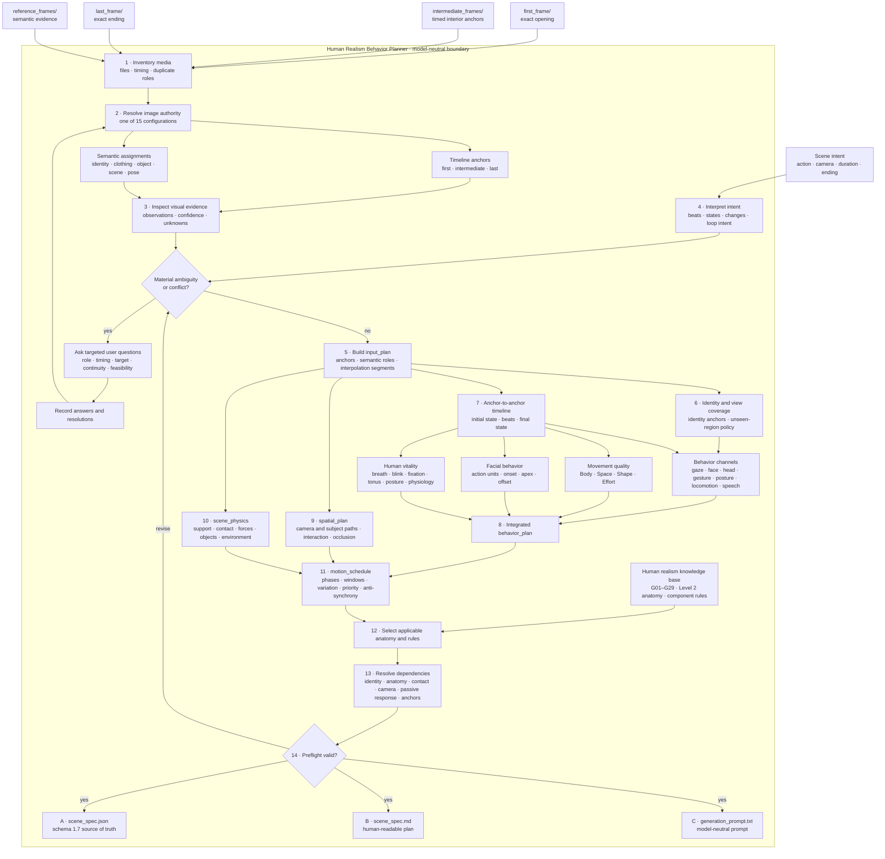

# Human Realism Behavior Planner

**Current subject scope:** Adult female human  
**Use case:** Model-neutral human behavior planning for photorealistic image-to-video work

This repository contains one Codex skill: the **Human Realism Behavior Planner**. It converts image evidence and a scene request into a complete, traceable behavior plan before any model-specific prompting or video generation.

The planner accepts any non-empty combination of:

- A first frame
- Timed intermediate frames
- A last frame
- Semantic reference images for identity, appearance, clothing, objects, environment, lighting, style, pose, or composition

It asks targeted questions when image roles, timing, semantic targets, continuity, or physical feasibility are materially ambiguous. Otherwise, it records reasonable assumptions and proceeds.

## Planner workflow



## What the planner covers

- All 15 non-empty combinations of first, intermediate, last, and semantic reference images
- Explicit separation of chronological anchors from unpinned reference evidence
- Identity anchors, viewpoint coverage, and policies for unseen regions
- Seven behavior channels and synchronized action phases
- Laban Body, Space, Shape, and Effort movement qualities
- Visibility-aware facial action planning
- Respiration, blinking, fixation, facial tonus, posture, and extended physiology
- Camera and subject paths, interactions, contact, occlusion, and reappearance
- Scene objects, support contacts, forces, environmental drivers, and passive dynamics
- Normalized motion schedules with bounded variation and anti-synchrony
- Anatomy and realism rules selected from the project knowledge base
- Structural and semantic preflight validation

## Outputs

The planner produces exactly three artifacts:

1. `scene_spec.json` — canonical structured plan matching schema 1.7
2. `scene_spec.md` — equivalent human-readable specification
3. `generation_prompt.txt` — direct model-neutral prompt derived from the plan

The planner does not generate or evaluate video.

## Repository layout

```text
.
├── README.md
├── Human Realism Behavior Planner/
│   ├── Human Appearance, Anatomy & Motion Realism Standard.md
│   ├── Standard Template A — Master Component Rule.md
│   ├── Standard Template B — Agent-Generated Scene Specification.md
│   └── images/
└── .agents/skills/human-realism-behavior-planner/
    ├── SKILL.md
    ├── agents/openai.yaml
    ├── references/
    │   ├── behavior-planning.md
    │   ├── motion-scheduling.md
    │   ├── multi-image-conditioning.md
    │   ├── output-contract.md
    │   ├── scene-spec.schema.json
    │   └── selection-policy.md
    └── scripts/
        ├── resolve_image_inputs.py
        ├── resolve_motion_schedule.py
        ├── validate_spec.py
        └── test_*.py
```

## Use the skill

Invoke **`$human-realism-behavior-planner`** with accessible images and the intended scene. For example:

> Use $human-realism-behavior-planner with these images. Preserve the person's identity, plan the requested action and camera behavior, ask me about any material ambiguity, and return the JSON specification, readable specification, and generation prompt.

For a folder-based workflow, create the relevant role directories under `generation_artefacts/input/images/` and place the scene request in `generation_artefacts/input/content.txt`. Then inventory the media:

```powershell
python .agents/skills/human-realism-behavior-planner/scripts/resolve_image_inputs.py generation_artefacts/input/images --duration 10
```

Validate a completed structured plan:

```powershell
python .agents/skills/human-realism-behavior-planner/scripts/validate_spec.py path/to/scene_spec.json
```

Resolve normalized timing for a known destination duration:

```powershell
python .agents/skills/human-realism-behavior-planner/scripts/resolve_motion_schedule.py path/to/scene_spec.json --duration 12 --output path/to/motion_schedule_resolved.json
```

## Knowledge base

The human-facing source folder contains:

- G01–G29 global human realism rules
- A 22-region head-to-toe anatomical inventory
- The reusable master component rule template
- The agent-generated scene specification template
- Example images used to illustrate appearance, pose, interaction, and motion cases

The current anatomical knowledge base focuses on adult female humans. The planner applies only the rules supported by the actual subject, framing, action, and visible evidence.
