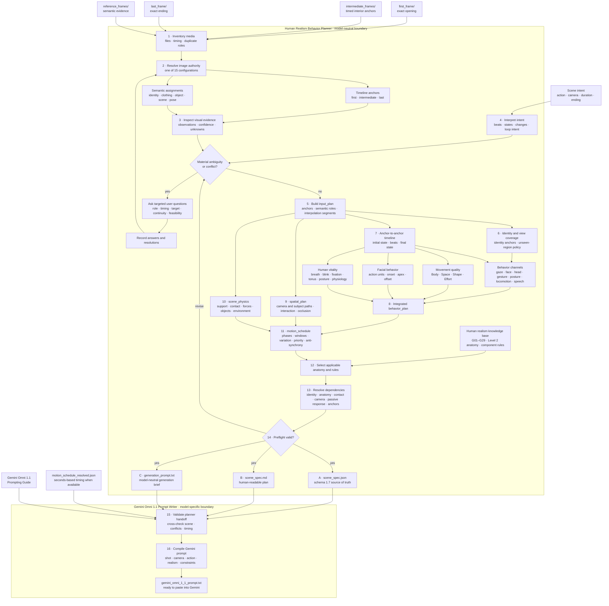
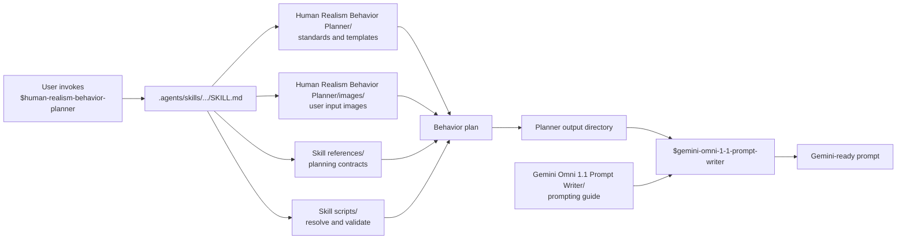

# Human Realism Video Workflows

**Current subject scope:** Adult female human  
**Use case:** Model-neutral human behavior planning followed by model-specific prompt compilation

This repository contains a two-stage Codex workflow:

1. **Human Realism Behavior Planner** converts image evidence and scene intent into a complete, traceable, model-neutral behavior plan.
2. **Gemini Omni 1.1 Prompt Writer** reads that completed handoff and compiles it, together with the Gemini prompting guide, into one ready-to-paste Gemini Omni 1.1 prompt.

Behavior decisions belong to stage 1. Model-specific wording belongs to stage 2. Neither skill generates or evaluates video.

The planner accepts any non-empty combination of:

- A first frame
- Timed intermediate frames
- A last frame
- Semantic reference images for identity, appearance, clothing, objects, environment, lighting, style, pose, or composition

It asks targeted questions when image roles, timing, semantic targets, continuity, or physical feasibility are materially ambiguous. Otherwise, it records reasonable assumptions and proceeds.

## Planner workflow



## What the planner covers

- All 15 non-empty combinations of first, intermediate, last, and semantic reference images
- Explicit separation of chronological anchors from unpinned reference evidence
- Identity anchors, viewpoint coverage, and policies for unseen regions
- Seven behavior channels and synchronized action phases
- Laban Body, Space, Shape, and Effort movement qualities
- Visibility-aware facial action planning
- Respiration, blinking, fixation, facial tonus, posture, and extended physiology
- Camera and subject paths, interactions, contact, occlusion, and reappearance
- Scene objects, support contacts, forces, environmental drivers, and passive dynamics
- Normalized motion schedules with bounded variation and anti-synchrony
- Anatomy and realism rules selected from the project knowledge base
- Structural and semantic preflight validation

## Outputs and handoff

The planner produces exactly three artifacts:

1. `scene_spec.json` — canonical structured plan matching schema 1.7
2. `scene_spec.md` — equivalent human-readable specification
3. `generation_prompt.txt` — model-neutral generation brief derived from the plan

When duration is known, `motion_schedule_resolved.json` provides the derived seconds-based schedule. The Gemini writer reads the complete planner output directory and adds:

4. `gemini_omni_1_1_prompt.txt` — the ready-to-paste model-specific prompt

## Repository layout

```text
.
├── README.md
├── Human Realism Behavior Planner/
│   ├── Human Appearance, Anatomy & Motion Realism Standard.md
│   ├── Standard Template A — Master Component Rule.md
│   ├── Standard Template B — Agent-Generated Scene Specification.md
│   └── images/
│       ├── first_frame/
│       ├── intermediate_frames/
│       ├── last_frame/
│       └── reference_frames/
├── Gemini Omni 1.1 Prompt Writer/
│   └── Gemini Omni 1.1 Prompting Guide.md
└── .agents/skills/
    ├── human-realism-behavior-planner/
    │   ├── SKILL.md
    │   ├── agents/openai.yaml
    │   ├── references/
    │   └── scripts/
    └── gemini-omni-1-1-prompt-writer/
        ├── SKILL.md
        ├── agents/openai.yaml
        ├── references/output-contract.md
        └── scripts/
            ├── validate_handoff.py
            └── test_validate_handoff.py
```

The top-level named folders contain the project knowledge and user inputs. `.agents/skills/` contains the discoverable Codex execution packages that tell Codex how to run each stage.



## Run the workflow

Invoke **`$human-realism-behavior-planner`** with accessible images and the intended scene. For example:

> Use $human-realism-behavior-planner with these images. Preserve the person's identity, plan the requested action and camera behavior, ask me about any material ambiguity, and return the JSON specification, readable specification, and model-neutral generation brief.

Place images in the matching role directories under `Human Realism Behavior Planner/images/`. Supply scene intent in the user request, then inventory the media:

| Folder | Purpose |
| --- | --- |
| `first_frame/` | Zero or one image defining the exact opening state. |
| `intermediate_frames/` | Zero or more interior timeline anchors. Add `timings.json` when this folder contains images. |
| `last_frame/` | Zero or one image defining the exact closing state. |
| `reference_frames/` | Unpinned evidence for identity, appearance, clothing, objects, environment, lighting, style, pose, or composition. Add `roles.json` to declare roles and targets. |

The folders may be empty, but at least one supported image must be present across them when the planner runs. Supported formats are PNG, JPEG, and WebP. The tracked `.gitkeep` files only preserve the empty directory structure and are ignored by the resolver.

```powershell
python .agents/skills/human-realism-behavior-planner/scripts/resolve_image_inputs.py "Human Realism Behavior Planner/images" --duration 10
```

Validate a completed structured plan:

```powershell
python .agents/skills/human-realism-behavior-planner/scripts/validate_spec.py path/to/scene_spec.json
```

Resolve normalized timing for a known destination duration:

```powershell
python .agents/skills/human-realism-behavior-planner/scripts/resolve_motion_schedule.py path/to/scene_spec.json --duration 12 --output path/to/motion_schedule_resolved.json
```

Then invoke **`$gemini-omni-1-1-prompt-writer`** on the directory containing those outputs:

> Use $gemini-omni-1-1-prompt-writer on `output/my-scene/` and write the Gemini Omni 1.1 prompt beside the planner artifacts.

Validate the handoff directly when needed:

```powershell
python .agents/skills/gemini-omni-1-1-prompt-writer/scripts/validate_handoff.py "output/my-scene"
```

## Knowledge base

The three Markdown documents at the planner root are all part of its knowledge base:

| File | Role in the planner |
| --- | --- |
| `Human Appearance, Anatomy & Motion Realism Standard.md` | Defines G01–G29 and the 22-region anatomical inventory. |
| `Standard Template A — Master Component Rule.md` | Defines the reusable anatomy, appearance, motion, physics, interaction, continuity, and applicability structure for a component rule. |
| `Standard Template B — Agent-Generated Scene Specification.md` | Defines how selected component rules are expressed for one planned scene. |

The current anatomical knowledge base focuses on adult female humans. The planner applies only the rules supported by the actual subject, framing, action, and visible evidence.
