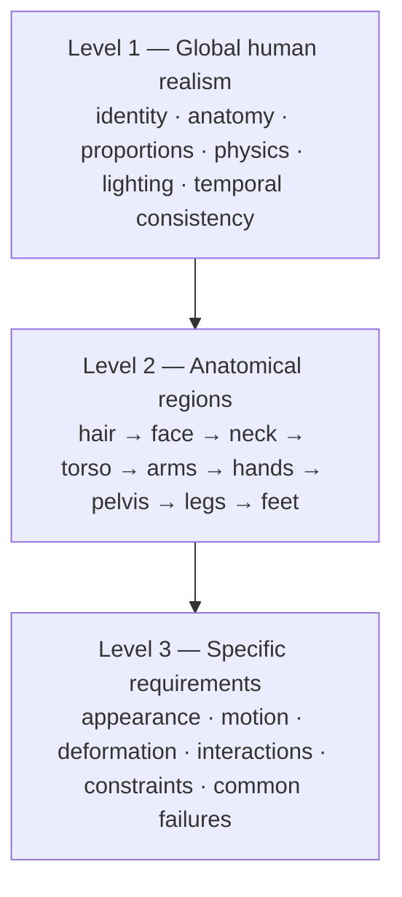
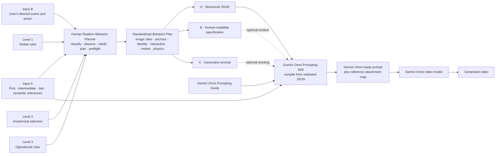
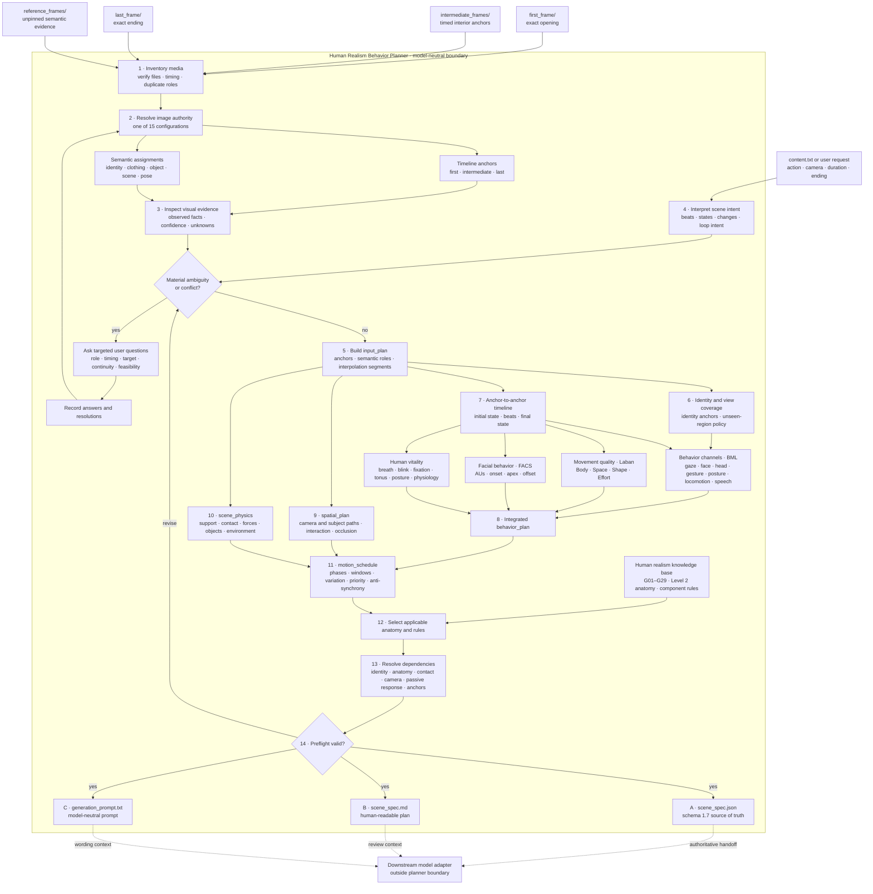
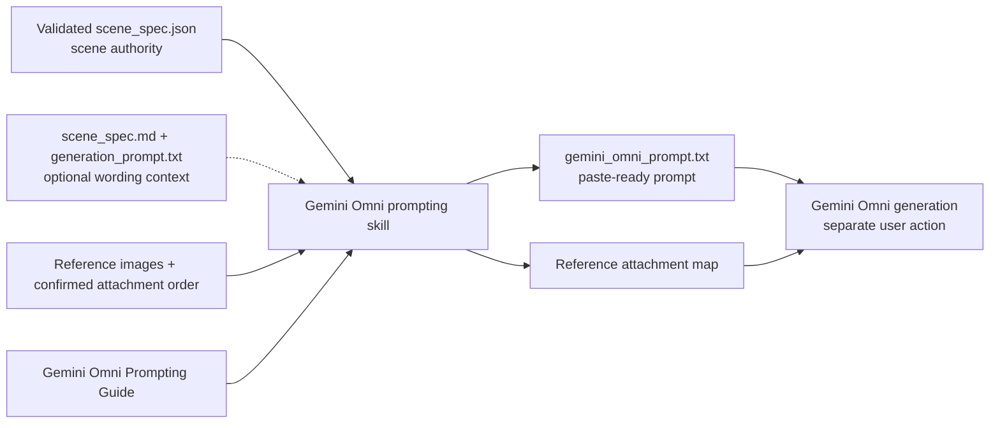

# Human Realism Video Workflows

**Version:** 1.0 working design  
**Current subject scope:** Adult female human  
**Use case:** Photorealistic image-to-video and multi-image-to-video scene planning

This repository develops workflows for realistic human image-to-video creation that can support different video models. It turns one or more reference images and a user's scene idea into a precise description of how a person should appear and move, then compiles that plan into a prompt for a chosen video model. The scene plan preserves what the images establish and makes the intended action explicit before generation.

The repository contains a three-level human realism standard, two Level 3 templates, and two Codex skills: the Human Realism Behavior Planner builds a model-neutral behavior plan, and the Gemini Omni adapter compiles that plan for a specific video model. Other adapters can be added without changing the underlying behavior plan. This README explains how those pieces fit together. The detailed anatomy and rule text remains in the linked guideline files.

## Why a three-level standard?

The original design discussion began with two layers: a head-to-toe inventory and whole-body consistency rules. It then developed those into Levels 1 and 2, followed by Level 3 for agent operation. This approach is a synthesis of character animation, VFX, and digital-human production practice, adapted to AI image-to-video generation. The head-to-toe organization is a custom framework for this project; traditional production can also organize work by modeling, rigging, animation, simulation, lighting, and rendering.

| Established field | Contribution to these guidelines |
| --- | --- |
| [Facial Action Coding System (FACS)](https://www.paulekman.com/facial-action-coding-system/) | Observable facial actions and expression components |
| [Skeletal animation and rigging](https://openusd.org/dev/api/_usd_skel__intro.html) | Joint hierarchies, connected movement, and deformation |
| Biomechanics | Posture, balance, locomotion, and movement limits |
| [Physics-based animation](https://help.autodesk.com/cloudhelp/2025/ENU/Maya-CharacterAnimation/files/GUID-0D0DCBE5-01BA-4AA2-BC4D-85C3285933AD.htm) | Gravity, inertia, collisions, and secondary response |
| VFX character production | Skin, hair, shading, lighting, and deformation; [MaterialX](https://materialx.org/Specification.html) and [OpenPBR](https://academysoftwarefoundation.github.io/OpenPBR/index.html) inform surface descriptions |
| [AI video evaluation research](https://arxiv.org/abs/2311.17982) | Vocabulary for subject consistency, motion smoothness, and temporal artifacts; generated-video evaluation is outside the current agent |

These sources do not jointly define a universal human image-to-video specification. The three-level structure is the project's proposed standard:

The original research foundation named five specific references:

| Reference | What it contributes to this design | Limit |
| --- | --- | --- |
| [Facial Action Coding System](https://www.paulekman.com/facial-action-coding-system/) | A vocabulary for observable facial movements, useful when describing coordinated brows, eyelids, cheeks, and mouth | It does not specify a whole-body image-to-video workflow |
| [OpenUSD skeletal animation](https://openusd.org/dev/api/_usd_skel__intro.html) | A model of skeletons, joint relationships, skinning, and connected movement | The scene specification is model-agnostic and does not require OpenUSD files |
| [MaterialX](https://materialx.org/Specification.html) | A reference for describing surface appearance and shading consistently | It does not determine a person's identity or action |
| [OpenPBR](https://academysoftwarefoundation.github.io/OpenPBR/index.html) | A common material model for plausible reflectance under illumination | It is a material reference, not a movement standard |
| [VBench](https://arxiv.org/abs/2311.17982) and [VBench++](https://arxiv.org/abs/2411.13503) | Language for subject consistency, temporal artifacts, motion, and image-to-video evaluation dimensions | The current skill creates a pre-generation plan and does not score a video |

The references inform different parts of the design. The actual requirements in this repository are a proposed synthesis, not a standard issued by those projects. The same framework can describe single-image and multi-image scenes, still portraits and full-body actions, camera changes, lighting changes, and person–object interaction.



Level 1 supplies the invariants; Level 2 supplies the head-to-toe inventory; Level 3 makes those requirements operational. Level 3 is further divided into a reusable master rule format (3A) and a scene-specific output format (3B).

| Level | Question it answers | Repository source |
| --- | --- | --- |
| 1 — Global human realism | What must stay believable throughout the shot? | [Human Appearance, Anatomy & Motion Realism Standard](<Human Realism Behavior Planner/Human Appearance, Anatomy & Motion Realism Standard.md>), G01–G29 |
| 2 — Anatomical regions | Which body parts can be observed or affected? | Same standard, 22 head-to-toe regions and their component IDs |
| 3A — Master component rule | How should a reusable component rule describe anatomy, appearance, motion, interaction, and applicability? | [Standard Template A — Master Component Rule](<Human Realism Behavior Planner/Standard Template A — Master Component Rule.md>) |
| 3B — Scene component specification | Which rules apply to this person, these references, and this action? | [Standard Template B — Agent-Generated Scene Specification](<Human Realism Behavior Planner/Standard Template B — Agent-Generated Scene Specification.md>) |

### Scope and principles retained from the design discussion

The working standard is written for an adult female human subject in photorealistic image-to-video generation. It is meant to be usable across video models. It accommodates one or more people, full or partial framing, a stationary subject, subtle idle behavior, facial performance, locomotion, and interactions with objects or the environment. Where a body region is absent, hidden, or irrelevant, the agent marks its applicability instead of forcing a requirement.

The core principles are to preserve reference-established identity; maintain anatomy, proportions, and connected body parts; make movement appropriate to the requested action; respect gravity, momentum, balance, collision, and contact; keep appearance, materials, lighting, and shadows coherent over time; synchronize related movements; preserve intentional stillness; and distinguish observed evidence from inference. Natural individual variation is valid. An intentional creative change should be recorded as a change rather than mistaken for reference drift.

| Term | Meaning in the guideline |
| --- | --- |
| MUST / SHOULD / MAY | Mandatory when applicable / recommended with context / optional |
| N/A | A requirement or component does not apply to this shot or subject |
| Primary motion | Deliberate action, such as a head turn or arm reach |
| Secondary motion | A response driven by another motion or force, such as hair lag after a turn |
| Deformation | Shape change caused by expression, movement, pressure, or contact |
| Temporal consistency | Stable identity, surfaces, and causal progression across frames |
| Reference fidelity | Preservation of properties established by the supplied images |

The first draft also made four useful distinctions:

1. **Primary versus secondary motion:** the intended action and its delayed physical responses need separate instructions.
2. **Appearance versus behavior:** what a component looks like and what it does are different fields.
3. **Anatomy versus physics:** anatomy constrains possible movement; physics governs forces and reactions.
4. **Single-frame versus temporal realism:** a plausible still frame can still be followed by morphing, flicker, or changing body-part counts.

### Level 1: global rules

The standard defines 29 rules, G01–G29. They cover identity and proportions; anatomy and joint limits; primary and secondary motion; gravity, balance, and contact; skin, hair, lighting, color, and material response; expression, gaze, breathing, and speech; clothing and environment; reference reconciliation; and frame-to-frame continuity. Rules apply when the scene makes them relevant. Stillness is valid, and hidden details are not treated as observed facts.

This is the complete Level 1 rule index. The linked standard holds each rule's objective, detailed requirements, and failure examples.

| ID | Global rule | Planning concern |
| --- | --- | --- |
| G01 | Identity Preservation | Same recognizable person throughout |
| G02 | Anatomical Integrity | Correct parts and connections |
| G03 | Body Proportion and Volume Consistency | Stable relative dimensions and mass |
| G04 | Skeletal Movement and Joint Constraints | Plausible joint range and hierarchy |
| G05 | Primary Motion | Deliberate action, direction, speed, and finish |
| G06 | Secondary Motion | Driven lag, elasticity, and settling |
| G07 | Gravity, Mass, and Momentum | Weight and inertial response |
| G08 | Posture, Balance, and Weight Distribution | Support and center of gravity |
| G09 | Surface Texture and Skin Integrity | Stable skin detail and texture |
| G10 | Skin and Soft-Tissue Deformation | Plausible stretch, compression, and volume |
| G11 | Lighting and Shadow Consistency | Coherent light direction and shadows |
| G12 | Material and Reflectance Behavior | Appropriate response of skin, hair, cloth, and other surfaces |
| G13 | Color and Pigmentation Consistency | Stable skin, hair, and feature color |
| G14 | Facial Expression Integrity | Coordinated expression components |
| G15 | Eye and Gaze Coordination | Plausible eye direction and focus |
| G16 | Breathing and Biological Micro-Movement | Subtle, coordinated biological motion when relevant |
| G17 | Speech and Oral Coordination | Mouth, jaw, tongue, and speech timing when requested |
| G18 | Contact and Collision Behavior | No floating, clipping, or broken grip |
| G19 | Movement Synchronization and Coordination | Related parts act together |
| G20 | Temporal and Frame-to-Frame Consistency | Stable identity and continuous motion |
| G21 | Perspective, Depth, and Occlusion | Correct depth, scale, and reappearance |
| G22 | Camera and Subject Relationship | Consistent framing and viewpoint |
| G23 | Clothing, Footwear, and Accessories | Attached items deform and follow motion |
| G24 | Environmental Interaction | Wind, surfaces, and surroundings affect the subject coherently |
| G25 | Behavioral Coherence | Body language fits the requested action |
| G26 | Reference Fidelity and Multi-Image Reconciliation | Preserve evidence and resolve multiple views |
| G27 | Frame-Rate and Motion Presentation | Motion reads smoothly at the intended presentation |
| G28 | Artifact Prevention and Error Control | Prevent morphing, duplication, flicker, and other defects |
| G29 | Contextual Applicability | Apply only what the scene supports or requires |


*A gentle smile depends on coordinated changes in the lips, cheeks, eyes, and jaw. This generated image illustrates the intended appearance; the rules describe how an expression develops through time.*


*A walking pose brings support, weight transfer, joint coordination, and frame-to-frame continuity into focus. The same global rules also apply to a person who remains still.*

### Level 2: anatomical map

Level 2 inventories components from scalp and hair through the face, torso, arms, hands, pelvis, legs, and feet. Its IDs, such as 01.03 for Head Hair and 14.01 for Hands — General, make a scene requirement traceable to an exact component. For a selected component, consider anatomy, appearance, motion, deformation, interaction, and continuity. A shot does not need an entry for every component in the inventory.


*This generated full-body view provides a visual subject anchor. Level 2 maps the visible regions from head to foot, including surface components, soft tissue, hair, skin, and clothing.*

| Region | Coverage in the component inventory |
| --- | --- |
| 01 — Hair and Scalp | Scalp, hairline, head hair, styled sections, flyaways |
| 02 — Forehead and Brows | Forehead, brow ridges, eyebrows, glabella |
| 03 — Eyes and Surrounding Structures | Lids, lashes, eyeballs, iris, pupils, cornea, under-eye area, temples |
| 04 — Nose | Bridge, tip, nostrils, nasal wings, septum, nasolabial area |
| 05 — Midface and Cheeks | Cheekbones, cheeks, midface tissue |
| 06 — Ears | Outer ear, rim, inner structures, lobes, canal opening |
| 07 — Mouth and Lower Face | Lips, corners, teeth, gums, tongue, jaw, chin |
| 08 — Neck and Throat | Front, sides, back, throat, shoulder transition |
| 09 — Shoulders and Clavicular Area | Clavicles, shoulders, joints, adjacent contours |
| 10 — Chest and Breasts | Chest wall, breast tissue, sternum, ribcage |
| 11 — Back and Spine | Upper and lower back, spine, shoulder blades |
| 12 — Upper Arms and Elbows | Upper arms and elbow structures |
| 13 — Forearms and Wrists | Forearms, wrist structure, tendons |
| 14 — Hands and Fingers | Hands, palms, fingers, joints, nails |
| 15 — Abdomen and Waist | Abdomen, navel, waist, side torso |
| 16 — Pelvis, Hips, and Buttocks | Pelvic and hip structure, buttocks, groin where relevant |
| 17 — Thighs | Thigh structure and soft tissue |
| 18 — Knees | Kneecaps, joint bending, skin folds |
| 19 — Lower Legs | Calves, shins, lower-leg shape |
| 20 — Ankles | Ankle structure, flexion, weight bearing |
| 21 — Feet | Foot shape, arches, heels, ground contact |
| 22 — Toes and Toenails | Toe articulation, spacing, nails |

The early draft began with a simpler body-part checklist. The final Level 2 file formalizes that inventory into numbered regions and components, allowing the agent to select a precise subset for each scene.


*A grasp depends on wrist, palm, finger, and thumb geometry. The scene specification also records when contact begins and how the object responds.*

### Level 3: operational rules and scene format

**Template A** defines twelve dimensions for a reusable component rule: anatomical definition, appearance, primary motion, secondary motion, deformation, interaction, temporal consistency, activation, failure conditions, acceptance criteria, dependencies, and applicability. The current file is a template, not a populated rule for every Level 2 component. The agent combines its dimensions with the actual Level 1 and Level 2 guidance.

**Template B** describes a component in a particular scene: reference observation, scene intent, appearance preservation, primary motion, secondary motion and physics, deformation and interaction, temporal continuity, negative constraints, and traceability. The saved template also contains an acceptance/evaluation section. The current agent does not emit that section because generated-video quality assessment is outside this workflow.

This distinction matters: a master rule may say that hair responds to head motion and gravity; a scene specification says whether the visible hair should move in this shot, what drives it, and what reference hairstyle must remain stable.

| Level 3 record | Purpose | Created when |
| --- | --- | --- |
| A — Master Component Rule | Reusable anatomy, appearance, physics, motion, activation, and dependency rules | During guideline development |
| B — Scene Component Specification | Exact requirements for one component in a requested scene | For each scene request |

Shared properties can be inherited rather than copied into hundreds of component rules; for example, skin regions can refer to common surface guidance. The present repository provides Template A, not a completed per-component 3A library.

The original **3A master record** identifies its rule ID, exact component, parent region, relevant Level 1 IDs, and version, then uses twelve dimensions:

| Dimension | Questions the reusable rule answers |
| --- | --- |
| 1. Anatomical definition | What is its structure, connection, natural variation, and movement limit? |
| 2. Appearance requirements | Which texture, color, detail, reflectance, light response, and reference traits matter? |
| 3. Primary motion | Which deliberate movements, directions, ranges, start and stop conditions are possible? |
| 4. Secondary motion | How do inertia, gravity, elasticity, damping, and settling affect it? |
| 5. Deformation | How does it stretch, compress, rotate, conserve volume, and maintain surface continuity? |
| 6. Interaction | What connected parts, clothing, objects, environment, collisions, and occlusions affect it? |
| 7. Temporal consistency | Which traits stay fixed, which may change, and how does it recover after occlusion? |
| 8. Activation conditions | In which scenes, actions, and camera views is the rule relevant or inactive? |
| 9. Failure conditions | Which anatomy, appearance, motion, physics, interaction, or temporal errors should be avoided? |
| 10. Acceptance criteria | What observable outcomes would a later review look for? This belongs to the source template, outside the current agent output. |
| 11. Dependencies | Which global rules, neighboring parts, synchronizations, and conflicting constraints apply? |
| 12. Applicability | When is the rule mandatory, optional, inapplicable, or unsupported by evidence? |

The original **3B scene record** identifies scene, subject, component, applicability, and priority. Its lettered fields specify what the agent must derive for that particular request:

| Field | Scene-specific content |
| --- | --- |
| A. Reference observation | Visible shape, color, texture, source image IDs, occlusion, confidence, unknowns |
| B. Scene intent | Requested action, the component's role, starting and final states |
| C. Appearance preservation | Stable traits, permitted changes, texture, lighting, silhouette |
| D. Primary motion | Whether motion is needed, trigger, direction, timing, speed, limits, coordination |
| E. Secondary motion and physics | Drivers, gravity, lag, damping, and settling |
| F. Deformation and interaction | Shape change, linked body parts, clothing, objects, contact, collision, occlusion |
| G. Temporal continuity | Fixed and changing properties, tracking, recovery, forbidden jumps |
| H. Negative constraints | Anatomy, motion, texture, lighting, and interaction failures to prevent |
| I. Acceptance criteria | Present in the original source template for later video review; omitted from this skill's deliverables |
| J. Traceability | Global and component rule IDs, reference images, user instructions, assumptions, conflicts |

For instance, a reusable hair rule describes how hair can follow head movement, gravity, and wind. A scene hair record says which forces exist in this shot, which hairstyle traits the image establishes, what timing the user requested, and what remains unknown. The agent selects relevant rules instead of copying the entire library into every response.

The first design draft used **eyebrows** to show why a component needs more than the same five labels repeated for every body part. A reusable eyebrow rule should cover anatomical placement, strand direction and density, color and lighting, deliberate raising or lowering, linked forehead deformation, expression coordination, realistic muscle-driven limits, frame-to-frame stability, and failures such as duplication or flicker. A scene record then selects only the eyebrow behavior that the requested expression actually needs.

### Component applicability

Visible does not automatically mean active. Eyelashes may be visible during a head turn but need no independent animation. Conversely, a component hidden in the first frame may matter when it is revealed later. Selection therefore considers the entire planned sequence.

| State | Meaning | Handling |
| --- | --- | --- |
| Active | Participates in the requested action | Specify motion and appearance |
| Visible-static | Visible without significant independent motion | Preserve appearance and stability |
| Occluded | Present but covered or hidden | Maintain continuity; define reappearance when relevant |
| Outside-frame | Outside the camera view | Avoid detailed visible requirements |
| N/A | Does not apply to this subject or action | Skip |
| Uncertain | Reference evidence is insufficient | Mark unknown; do not fabricate details |

When requirements conflict, the original framework orders them as follows: applicable safety and consent constraints; explicit scene instructions and intentional changes; reference-established identity and appearance; anatomical and physical plausibility; scene-inferred behavior; optional embellishment. An intentional transformation should be labeled as such, while unresolved conflicts should be reported rather than silently merged.

The Level 3 discussion described a component selection procedure. The behavior planner extends it with an explicit realism-selection gate so omitted physiology cannot disappear between the standard and the model prompt:

| Stage | Decision |
| --- | --- |
| 01. Resolve image roles | Separate first, last, and timed intermediate anchors from unpinned semantic references |
| 02. Analyze references | Identify people, visible anatomy, pose, appearance, clothing, and unknown areas |
| 03. Interpret intent | Find actions, camera behavior, environmental forces, and transitions |
| 04. Repair intent | Ask about material ambiguity and record resolutions for omissions, conflicts, and physical impossibilities |
| 05. Select baseline realism | Decide respiration, blinking, ocular fixation, facial tonus, postural adjustment, and repeated-action variation for every subject |
| 06. Plan space and interaction | Separate camera and subject trajectories; define reference coverage, affordances, contact, reactions, and occlusion |
| 07. Build timeline | Order states, movements, reactions, anchor transitions, and ending conditions |
| 08. Schedule motion | Assign normalized primary, vitality, and secondary windows with bounded variation and anti-synchrony |
| 09. Select components | Assign the six applicability states to relevant Level 2 entries and support every active baseline cue |
| 10. Apply rules | Attach the relevant Level 1 constraints and derive the 3B component records |
| 11. Resolve dependencies | Check joints, synchronization, anchor boundaries, physical drivers, occlusion, collision, variation, and conflicts |
| 12. Validate and package | Check completeness, input roles, segment coherence, contradictions, traceability, and format before output |

## Agent workflow and downstream generation

The [Human Realism Behavior Planner](<.agents/skills/human-realism-behavior-planner/SKILL.md>) accepts first, last, timed intermediate, and semantic-reference images in any non-empty combination with the user's scene intent. It prepares A, B, and C. The existing [Gemini Omni prompting skill](<.agents/skills/gemini-omni-human-realism-video-prompting/SKILL.md>) uses A as the authoritative handoff, with B/C and media mapping as context. Video generation itself is a later stage.



### Human Realism Behavior Planner in detail

The first agent owns everything inside the boundary below. Its job is to convert image evidence and sparse scene intent into a complete, traceable, model-neutral behavior plan. The model adapters begin only after A–C are complete.



The standardized behavior plan is the stable handoff. Different video models may need different prompt phrasing, input image handling, or settings; those adaptations should preserve the same subject, action order, constraints, and uncertainty. The behavior planner stops after A, B, and C. Model-specific compilation begins outside the planner boundary. Neither the planner nor the existing Gemini adapter evaluates generated-video quality.

### Operational steps

1. **Input-role resolution:** Classify each image as a first, last, or timed intermediate anchor, an unpinned semantic reference, or an explicit dual role. Derive one of fifteen supported configurations and divide the clip into anchor-to-anchor segments.
2. **Reference analysis:** Examine each image; identify subjects, visible anatomy, pose, appearance, clothing, accessories, setting, and unknowns without transferring evidence beyond the image's assigned role.
3. **Intent interpretation and clarification:** Translate the request into actions, expressions, interactions, state changes, and anchor transitions. Ask targeted questions when image role, timing, semantic target, loop behavior, or physical continuity is materially ambiguous; record answers and other material repairs.
4. **Baseline realism selection:** For each subject, explicitly decide respiration, blinking, ocular fixation, facial tonus, postural micro-adjustment, and bounded variation for repeated action.
5. **Behavior and scene physics:** Decide all seven behavior channels and applicable phase synchronization, movement quality for each beat, visible facial actions, extended physiology, causal passive dynamics, objects, force fields, support/contact, and environmental effects.
6. **Spatial and interaction planning:** Define identity anchors and reference coverage, separate camera and subject trajectories, structure human-object or human-human interaction, and record occlusion and reappearance constraints.
7. **Motion scheduling:** Give every subject normalized primary-phase windows aligned to input segments, vitality tracks, driven secondary tracks, coordination rules, and anti-synchrony rules. Assign bounded differences to repeated phases without prescribing per-frame animation.
8. **Anatomical selection:** Review Level 2 and classify each relevant component using the six applicability states. Detail active parts, preserve visible-static ones, account for relevant occlusion, and map active baseline cues to supporting components and G16.
9. **Rule application:** Apply Level 1 invariants and matching 3A dimensions to anatomy, appearance, primary and secondary motion, deformation, physics, interaction, lighting, continuity, and failure prevention.
10. **Dependency resolution:** Synchronize connected body parts, respiration, gaze, expression, contact, balance, anchor boundaries, secondary motion, occlusion, timing, and bounded human variation.
11. **Plan construction:** Build the Level 3B scene plan with input roles, anchors, semantic assignments, interpolation segments, subjects, timeline, realism selection, behavior plan, spatial plan, scene physics, motion schedule, intent resolutions, component requirements, traceability, assumptions, and unresolved information.
12. **Preflight validation:** Check role configuration, anchor timing, semantic targets, segment coverage, transition feasibility, identity and viewpoint coverage, camera and subject paths, interaction structure, requested-action coverage, baseline-cue disposition, schedule coverage, repetition variation, driven secondary response, physical coherence, reference fidelity, and traceability.
13. **Output A–C:** Emit schema 1.7 JSON, an equivalent readable specification, and a concise generation prompt compiled from the input, behavior, spatial, and motion plans.

The agent accepts optional duration, camera direction, environment, target video model, and other visual or movement constraints. When a necessary image, image role, intermediate timestamp, semantic target, or core action is missing, it requests that input. When only a reversible detail is uncertain, it can proceed with a labeled assumption. Multiple references are evidence to reconcile, not faces or body features to average together, and alternate views do not become timeline frames unless explicitly assigned.

The guiding principle is to preserve what the images establish, animate the requested scene, and infer the minimum visible physiology needed for a living subject to remain natural. Baseline life cues are explicit selection decisions rather than optional embellishments.

## Output contract

| Output | Purpose | What it contains |
| --- | --- | --- |
| **A — Structured scene specification** | Stable machine-readable record | Image-role configuration, timeline anchors, semantic assignments, interpolation segments, scene and reference IDs, identity anchors, subjects, ordered beats, camera and subject paths, interactions, realism decisions, intent resolutions, selected rules, component entries, assumptions, and unresolved conflicts |
| **B — Human-readable specification** | Review and editing | The same scene plan, baseline cues, variation, and constraints in readable language, with visible evidence and uncertainties |
| **C — Generation prompt** | Initial model-facing phrasing | Subject preservation, action sequence, camera, concrete baseline behavior, bounded variation, physical response, and high-priority exclusions; the selected model skill recompiles it from A |

The JSON field names and allowed values are defined by the [schema](<.agents/skills/human-realism-behavior-planner/references/scene-spec.schema.json>) and explained in the [output contract](<.agents/skills/human-realism-behavior-planner/references/output-contract.md>). For every component, the specification distinguishes what is observed from what is planned. Component and rule IDs remain traceable to the standard. A pre-generation [structural validator](<.agents/skills/human-realism-behavior-planner/scripts/validate_spec.py>) checks that IDs and references are valid; it does not judge generated video.

The deliverable deliberately excludes a quality assurance checklist, pass/fail evaluation, and post-generation review.

The Level 3 chat recommended **JSON as the canonical representation**, followed by readable prose and a prompt compiled for the selected video model. JSON gives software a stable way to store, filter, and check a scene plan. The chat's compact JSON was explicitly an illustration, not a formal schema; it showed a five-second head-turn scene, a hair component, source image IDs, rule references, assumptions, and placeholder validation fields. The repository now supplies a formal schema and structural checks, with this mapping:

| Design concept from the chat | Current structured output |
| --- | --- |
| Scene and subject identity | `scene_id` and `subjects` |
| Evidence and reference policy | `references`, subject reference IDs, component observations, confidence, and unknowns |
| Image authority and chronology | `input_plan` with one of fifteen configurations, ordered frame anchors, semantic assignments, dual roles, conflicts, loop intent, and interpolation segments |
| Desired action, duration, camera, and ordered events | `intent` with initial state, beats, and final state |
| Baseline vitality and natural repetition | `realism_selection` with five cue decisions and `repetition_variation` per subject |
| Human behavior and expression | `behavior_plan` with seven channels and phase synchronization, Body/Space/Shape/Effort, facial AU timing and combinations, extended physiology, and passive-dynamics propagation |
| Identity, viewpoints, and interaction | Subject `identity_anchors`, `view_coverage`, and `unseen_region_policy`, plus `spatial_plan` camera and subject tracks, affordance-based interactions, and occlusion events |
| Contact and environment | `scene_physics` with known objects, qualitative force fields, support contacts, environmental drivers, and typed visual dependencies |
| Temporal orchestration | `motion_schedule` with normalized primary phases, vitality tracks, driven secondary tracks, coordination, and anti-synchrony rules |
| Repairs to incomplete or incompatible intent | `intent_resolutions` with the source issue, disposition, resolution, and rationale |
| Global invariants | `global_rules` with G IDs and scene-specific constraints |
| Anatomical rules chosen for the scene | `components` with Level 2 IDs, applicability, priority, motion, physics, interaction, continuity, and traceability |
| Inference and unresolved information | `assumptions` and `unresolved_conflicts` |

The sample in the chat included video-evaluation placeholders because the wider architecture contemplated later assessment. They are deliberately absent from the current schema. Schema 1.7 requires explicit image roles, anchor timing, semantic targets, interpolation segments, identity and viewpoint coverage, explicit camera and subject tracks, structured interactions, behavior-channel and movement-quality coverage, facial expression timing, causal dynamics, scene contacts, motion-source authority, explicit tempo, articulated actions, vitality scheduling, and intent resolution; earlier artifacts must be regenerated or migrated. Preflight checks only the plan's structure and coherence before generation. The readable specification and prompt must agree with the JSON on image authority, identity, action order, temporal relationships, baseline cues, variation, and constraints.

### Architecture layers

| Layer | Responsibility |
| --- | --- |
| Level 1 | Supply global human realism constraints |
| Level 2 | Identify anatomical components and their relevant requirements |
| Level 3A | Provide the reusable format for component rules |
| Level 3B | Record the scene-specific component plan |
| Agent orchestration | Interpret images and intent, select rules, order events, resolve dependencies, and preflight the plan |
| Prompt compilation | Translate the completed specification into instructions suitable for the chosen video model |
| Downstream generation | Use the prompt and permitted references to create the video in a separate workflow |

## Gemini Omni prompt handoff

<a href="https://deepmind.google/models/gemini-omni/"></a>

*The Gemini mark identifies the target model. The scene specification and prompting skills in this repository are project tools.*

The second skill is [Gemini Omni Human Realism Video Prompting](<.agents/skills/gemini-omni-human-realism-video-prompting/SKILL.md>). It uses the validated **A — JSON specification** as its source of truth. The first skill's B and C can help with wording, but they cannot change the planned scene. The local [Gemini Omni Prompting Guide](<Gemini Omni Human Realism Video Prompting Skill/Gemini Omni Prompting Guide.md>) supplies the model-specific guidance on framing and camera movement, realistic style, lighting, location, action, and concise treatment of complex motion. The new skill does not need to reread the full anatomical inventory to compile a prompt because A already selects the relevant rules and components.

The handoff takes `scene_spec.json` and, when available, `scene_spec.md`, `generation_prompt.txt`, the reference images or handles, their attachment order, and any target-surface preference such as Gemini, Flow, or an API workflow. It returns a single ready-to-paste Omni prompt, plus a short mapping of specification reference IDs to the actual image attachments. It does not attach media or generate a video on its own. If reference images are unavailable, it identifies which ones the user must attach. If a conflict in A would change identity, action, contact, camera, or the ending, it asks for a decision before producing a definitive prompt.

The compiler preserves the scene's initial state, beat order, final state, identity, deliberate appearance changes, camera instructions, and important physical interactions. It uses Omni-friendly natural language and selects only the constraints that materially affect the shot. It does not invent timecodes, a new setting, music, speech, or extra camera moves. When the scene requires a continuous shot, it says so explicitly: [Google's Omni prompt guide](https://deepmind.google/models/gemini-omni/prompt-guide/) recommends direct camera language, while the [Gemini API guide](https://ai.google.dev/gemini-api/docs/omni) notes that Omni may otherwise choose multiple shots and accepts natural-language event timing. Those online documents supplement the local guide; the completed JSON remains the scene authority.



The reference mapping matters because a specification ID such as `R1` is the project's identifier, not automatically Gemini's first uploaded image. API-specific image tags are used only when that surface and the actual upload order are known. The skill's [prompt compilation notes](<.agents/skills/gemini-omni-human-realism-video-prompting/references/prompt-patterns.md>) document the field mapping and a worked prompt.

### How the Gemini Omni guide changes the wording

The guide is a writing aid for the final prompt. It does not replace evidence from the reference images or add new actions to the scene. The compiler chooses the guide elements that apply to this shot:

| Gemini Omni guide topic | Scene-plan input | Result in the final prompt |
| --- | --- | --- |
| Shot framing and motion | `intent.camera`, reference framing, and action beats | Name a wide, medium, or close view only when established; state the requested camera movement or stillness. |
| Style | User intent and stable appearance | Describe the intended photorealistic or cinematic feel without changing the person's identity or wardrobe. |
| Lighting | `intent.setting`, reference observations, and selected lighting constraints | Preserve known light direction and mood; do not invent a new source when the plan leaves it open. |
| Location | Setting and visible reference context | Keep the requested or reference-established environment, without burying the subject action in scenery. |
| Action | Initial state, ordered beats, final state | Tell Omni what changes and in what order, including the final held pose. |
| Direct camera language | Camera instructions and continuity needs | Say “one continuous shot,” “locked off,” or a specific movement when the plan calls for it. |
| World understanding | Selected anatomy, physics, contact, and balance rules | Use plain physical causes and effects instead of a long list of rule codes. |
| Complex actions | Beat dependencies and component interactions | Describe the action and its crucial contact sequence without prescribing every frame. |


*Project diagram: the mug example distilled into five prompt layers. The exact wording and reference order always come from the validated scene, not from this illustration.*

### Reference media and prompt delivery

The user supplies the actual reference images to Gemini Omni when generating a video. The prompt skill records how each image ID in the JSON maps to that upload. With one image, it can say “the attached image”; with multiple images, it names the role of the first, second, and later attachments after confirming their order. If the images are not available while the prompt is drafted, the handoff lists which ones still need to be attached. It never claims Omni has seen an image merely because its path appears in `scene_spec.json`.

The deliverable is the text in `gemini_omni_prompt.txt` plus the attachment map in the accompanying reply. The JSON stays as the project record; the full JSON, anatomical component IDs, and rule library are not pasted into Omni. When the destination is unspecified, the prompt uses portable natural language. In a Gemini or Flow interface, the attachment roles can be expressed in ordinary words. In an API workflow, image-reference tags can be considered after the actual upload order is known and checked against [current Gemini API documentation](https://ai.google.dev/gemini-api/docs/omni).

This separation lets the same scene plan support another video model later. A new model adapter should preserve reference roles, identity, beat order, camera intent, interactions, and uncertainty while changing only the model-facing phrasing and media handoff.


## Worked example 1: head turn, smile, and breeze

*Illustrative inputs, not claims about an actual supplied photograph.* Suppose reference **R1** shows an adult woman facing the camera, with shoulder-length wavy brown hair, visible eyes, and her upper torso in frame. The user requests: “Make her slowly turn her head to the left, give a gentle smile, and let a light breeze move her hair. Keep everything natural and realistic.”


*This generated scene visualizes a possible result of the head turn and light breeze. It is not the hypothetical input R1 or evidence of the requested motion over time.*

For this example, a five-second shot is an **assumption**, not a duration supplied by the user. The plan is: 0–1 seconds, hold the starting pose; 1–3 seconds, turn the head left with coordinated eyes and hair movement; 3–4 seconds, form a gentle smile through the lip corners and cheeks; 4–5 seconds, settle the turn and breeze response while the smile remains. The agent would distinguish whether “left” means the subject's left or screen left if that affects a real production prompt.

The original design discussion expanded three component records for this scenario:

| Component | Reference traits to retain | Scene behavior and dependencies | Failures to prevent |
| --- | --- | --- | --- |
| 01.03 — Head Hair | Shoulder-length wavy brown hair; length, color, wave pattern, density, style, hairline | Roots follow the head; loose lengths lag and settle; light breeze adds subtle directional movement; gravity, collision, and damping still apply | Hair entering the face, neck, or shoulders; melting, flicker, disconnected strands, changing length |
| 07.03 — Lip Corners | Resting mouth geometry, lip contour, pigmentation, facial identity | Both corners rise gradually; cheeks and nearby skin move with them; the smile develops during the latter part of the turn | Detached lip motion, rigid cheeks, a sudden expression jump, excessive stretching |
| 08.02 — Sides of Neck | Visible neck shape, length, thickness, resting posture | Support slow head rotation with plausible alignment; subtle muscle contour and skin-fold changes coordinate with jaw and shoulders | Disconnected head, excessive twist, neck stretching, abrupt stop |

Cheeks and eyes are also active. Jaw, relevant eyelids, and possibly eyebrows depend on what the reference and requested expression show. Shoulders and upper chest normally receive stability constraints, with a small supporting adjustment only if needed.

**A — structured specification, selected fields**

```json
{
  "scene_id": "head-turn-smile-breeze-01",
  "references": [{"id": "R1", "observed": "Frontal adult woman, shoulder-length wavy brown hair, visible eyes and upper torso"}],
  "beats": [
    {"id": "B1", "time_s": [0, 1], "action": "Hold the reference pose"},
    {"id": "B2", "time_s": [1, 3], "action": "Turn the head slowly left; eyes coordinate and hair responds"},
    {"id": "B3", "time_s": [3, 4], "action": "Form a gentle smile with lip corners and cheeks"},
    {"id": "B4", "time_s": [4, 5], "action": "Settle the turn and hair; keep the smile"}
  ],
  "selected_rules": ["G01", "G02", "G04", "G06", "G07", "G14", "G15", "G20", "G22", "G24", "G26", "G29"],
  "selected_components": [
    {"id": "01.03", "name": "Head Hair", "role": "Respond to both the head turn and a light breeze, then settle"},
    {"id": "07.03", "name": "Lip Corners", "role": "Lift subtly to initiate a gentle smile"},
    {"id": "08.02", "name": "Sides of Neck", "role": "Support a plausible, limited head turn"}
  ],
  "preserve": ["Reference identity", "Hair length, color, and wave pattern", "Upper torso stability"],
  "avoid": ["Identity drift", "Neck twisting beyond a plausible range", "Hair moving without a cause", "Abrupt or exaggerated smile"]
}
```

This excerpt shows the main decisions. The agent's actual A output uses every required field of the linked JSON schema, including per-component observations and traceability.

**B — human-readable specification.** Begin in the observed frontal pose. Turn the head slowly to the intended left through a plausible neck range while the eyes follow coherently. Let the visible wavy hair react to both the head movement and a light breeze, with small delayed motion that settles. Then raise the lip corners and cheeks into a gentle smile and hold it through the final beat. Keep the visible shoulders and upper torso stable unless a slight connected adjustment is needed. Preserve the reference face and hairstyle. The five-second timing and fixed camera are illustrative staging assumptions; confirm them if a target model or shot plan requires exact values.

**C — generation prompt.** “Use R1 as the identity and appearance reference. In an approximately five-second portrait shot, the woman starts facing the camera, slowly turns her head to her left with coordinated eye movement, then forms a gentle smile and holds it. A light breeze softly moves her shoulder-length wavy brown hair; let the hair respond naturally to both the turn and breeze, then settle. Keep facial structure, hair style, and upper torso consistent. Avoid identity drift, exaggerated neck rotation or smile, disconnected gaze, and unexplained or perpetual hair motion.”

**Gemini Omni handoff, assuming R1 is attached first and the direction is confirmed as the subject's left.** “Use the attached image as this woman's identity and appearance reference. In one continuous, naturally lit portrait shot of approximately five seconds, begin with her facing the camera. She slowly turns her head to her left, her eyes following naturally. A light breeze gives her shoulder-length wavy hair subtle delayed movement, and it settles as she forms and holds a gentle smile. Preserve her face, hairstyle, and visible clothing. Keep the neck turn comfortable and the expression restrained; avoid identity drift, disconnected gaze, and hair motion without a cause.” This prompt expresses the same scene in Omni-oriented language. The timing remains an explicitly assumed choice, not a fact in R1.

## Worked example 2: reaching for a mug

*Illustrative inputs, not claims about actual supplied photographs.* Suppose **R1** is a front view of a woman standing beside a table, with her right hand and a mug visible; **R2** is a side view of the same person that clarifies arm proportions and the mug's position. The user requests: “She reaches with her right hand, grasps the mug, lifts it to chest height, and holds it. Keep her feet planted and the camera still.”


*This generated scene visualizes the contact beat. It is not either hypothetical reference image; the later lift and hold are described in the specification below.*

**A — structured specification, selected fields**

```json
{
  "scene_id": "mug-reach-01",
  "references": [
    {"id": "R1", "observed": "Front view, standing pose, right hand and mug visible"},
    {"id": "R2", "observed": "Side view clarifies right arm and mug placement"}
  ],
  "beats": [
    {"id": "B1", "action": "Stand with feet planted"},
    {"id": "B2", "action": "Reach the right arm toward the mug"},
    {"id": "B3", "action": "Close the hand around the mug and establish contact"},
    {"id": "B4", "action": "Lift the mug to chest height and hold it"}
  ],
  "selected_rules": ["G01", "G02", "G04", "G08", "G18", "G19", "G20", "G21", "G26"],
  "selected_components": [
    {"id": "09.03", "name": "Shoulder Joints", "role": "Initiate a connected arm reach"},
    {"id": "12.04", "name": "Elbows", "role": "Bend naturally as the hand approaches and lifts"},
    {"id": "13.04", "name": "Wrists", "role": "Orient the hand to the mug"},
    {"id": "14.01", "name": "Hands — General", "role": "Establish and maintain grip contact"},
    {"id": "21.01", "name": "Feet — General", "role": "Maintain planted support"}
  ],
  "preserve": ["Same person across both references", "Arm proportions", "Stable mug shape", "Foot-to-ground contact"],
  "avoid": ["Finger fusion", "Hand passing through mug", "Mug floating before grip", "Unmotivated foot sliding"]
}
```

**B — human-readable specification.** Begin standing beside the table with both feet planted. The right shoulder, elbow, wrist, and hand coordinate a single reach. The hand makes contact before the mug leaves the table; fingers wrap around it and retain a consistent grip while the arm lifts it to chest height. The torso makes only the balance adjustment needed for the reach. The mug stays the same object, and the camera remains fixed. R1 and R2 inform the same person's appearance; any conflicting detail would be recorded rather than silently merged.

**C — generation prompt.** “Use R1 and R2 as references for the same woman. In one fixed shot, she stands beside the table with her feet planted, reaches with her right arm, grips the visible mug, lifts it smoothly to chest height, and holds it. Keep her identity and arm proportions consistent. Coordinate shoulder, elbow, wrist, and fingers; establish hand contact before the mug rises, maintain the grip, and keep grounded balance. Avoid fused fingers, hand–mug intersections, a floating mug, foot sliding, and abrupt changes of scale or appearance.”

**Gemini Omni handoff, assuming R1 and R2 are attached in that order.** “Use the first attached image for the woman's identity and front appearance, and the second for the same woman's side proportions and the mug's position. In one continuous, locked-off shot, she stands beside the table with both feet planted. She reaches with her right arm, makes contact with the mug, closes her hand into a stable grip, then lifts the mug smoothly to chest height and holds it. Her shoulder, elbow, wrist, and fingers move together; her torso makes only the balance adjustment needed for the reach. Preserve her appearance and the mug's shape. The mug moves only after the grip is established; keep her feet grounded and her hand clear of the mug surface.” The attachment order is part of the handoff, not inferred from the names R1 and R2 alone.

These examples use different kinds of motion: a head turn with expression and driven secondary hair motion, and a multi-joint action with object contact and weight support. Their JSON blocks are deliberately short excerpts; the full agent output follows the schema.

## Using the Codex skill

Open this repository in Codex and provide the image or images with a scene request. Invoke **$human-realism-behavior-planner** when you want the behavior plan explicitly. A useful request is:

> Use $human-realism-behavior-planner with these references. Keep the person recognizable. Describe the intended action, camera behavior, and final pose, then return the JSON specification, readable specification, and generation prompt.

If saved as files, the outputs are named scene_spec.json, scene_spec.md, and generation_prompt.txt. The JSON can be checked with:

    python .agents/skills/human-realism-behavior-planner/scripts/validate_spec.py path/to/scene_spec.json

For the repository folder workflow, put images in the matching role folders under `generation_artefacts/input/images/`, put scene intent in `generation_artefacts/input/content.txt`, and inventory the input before planning:

    python .agents/skills/human-realism-behavior-planner/scripts/resolve_image_inputs.py generation_artefacts/input/images --duration 10

`first_frame/` and `last_frame/` each accept at most one image. Interior anchors go in `intermediate_frames/` with `timings.json`. Unpinned identity, appearance, clothing, object, environment, lighting, style, pose, or composition evidence goes in `reference_frames/`; optional `roles.json` can declare its intended semantic scope and targets. The planner asks before final output when timing, role, target, duplication, loop behavior, or anchor-to-anchor feasibility remains material and unresolved.

Then invoke **$gemini-omni-human-realism-video-prompting** with the validated JSON and the reference images or their attachment order. A useful request is:

> Use $gemini-omni-human-realism-video-prompting on this scene_spec.json. I will attach R1 first and R2 second. Return the Gemini Omni prompt and tell me which references to provide.

If no JSON exists yet, the Gemini skill runs the behavior planning stage first when the images and scene intent are available. If a prompt is saved, its filename is `gemini_omni_prompt.txt`.

## Repository map

```text
.
├── README.md
├── Human Realism Behavior Planner/
│   ├── Human Appearance, Anatomy & Motion Realism Standard.md
│   ├── Standard Template A — Master Component Rule.md
│   ├── Standard Template B — Agent-Generated Scene Specification.md
│   └── images/
│       ├── PROMPTS.md
│       ├── woman-full-body.png
│       ├── woman-gentle-smile.png
│       ├── woman-head-turn-breeze.png
│       ├── woman-mug-grip.png
│       ├── woman-mug-reach.png
│       └── woman-walking.png
├── Gemini Omni Human Realism Video Prompting Skill/
│   ├── Gemini Omni Prompting Guide.md
│   └── images/
│       ├── google-gemini-icon-2025.svg
│       └── omni-prompt-anatomy.svg
└── .agents/skills/
    ├── human-realism-behavior-planner/
    │   ├── SKILL.md
    │   ├── agents/openai.yaml
    │   ├── references/
    │   │   ├── behavior-planning.md
    │   │   ├── motion-scheduling.md
    │   │   ├── multi-image-conditioning.md
    │   │   ├── output-contract.md
    │   │   ├── scene-spec.schema.json
    │   │   └── selection-policy.md
    │   └── scripts/
    │       ├── validate_spec.py
    │       ├── resolve_image_inputs.py
    │       ├── resolve_motion_schedule.py
    │       ├── test_resolve_image_inputs.py
    │       ├── test_validate_spec.py
    │       └── test_resolve_motion_schedule.py
    └── gemini-omni-human-realism-video-prompting/
        ├── SKILL.md
        ├── agents/openai.yaml
        └── references/prompt-patterns.md
```

The named folders keep the human-facing source material together. The skills remain under .agents/skills so Codex can discover them. Future work can populate Template A with component-specific master rules or add further model adapters while retaining the same behavior-plan handoff.

## Design record and current status

The original design conversation developed this in stages: an initial head-to-toe inventory and whole-body rules; researched Levels 1 and 2; Level 3A and 3B templates; applicability and precedence rules; the agent workflow; and an illustrative structured output. This README preserves the architecture, rationale, research trail, diagrams, operational decisions, and examples. The three linked guideline documents preserve the detailed rule text.

| Design item | Current state |
| --- | --- |
| Level 1 global rules | 29 groups documented in the standard |
| Level 2 anatomical inventory | 22 regions with numbered components documented in the standard |
| Level 3A master rule format | Template exists; a full per-component rule library remains future work |
| Level 3B scene format | Template exists and is applied by the skill |
| Formal scene JSON schema and structural tests | Implemented in the skill |
| Generic motion variation scheduler | Introduced in schema 1.4 and retained in schema 1.7 with motion-source authority, real-time tempo, movement bursts and dwells, velocity profiles, articulated chains, prioritized vitality, existing-dwell protection, and destination-time resolution |
| Behavior planning and clarification | Implemented in schema 1.7 with channel coverage, movement quality, facial action timing, physiology and secondary-dynamics links, scene contacts, and a question gate for material ambiguity |
| Identity, viewpoint, and interaction planning | Implemented in schema 1.7 with identity anchors, reference coverage, separate camera and subject tracks, structured affordances and reactions, and occlusion/reappearance constraints |
| Multi-image conditioning | Implemented in schema 1.7 with all fifteen non-empty input combinations, timeline anchors, semantic role and target assignments, dual-role declarations, role conflicts, loop intent, interpolation segments, folder resolution, and clarification rules |
| Agent orchestration and outputs A–C | Implemented in the skill |
| Gemini Omni prompt compilation | Implemented as the second skill; consumes validated A and a reference attachment map |
| Other model-specific prompt adapters | Can be added without changing the behavior plan |
| Generated-video review | Outside the current skill |

The research references are [FACS](https://www.paulekman.com/facial-action-coding-system/), [OpenUSD UsdSkel](https://openusd.org/dev/api/_usd_skel__intro.html), [MaterialX](https://materialx.org/Specification.html), [OpenPBR](https://academysoftwarefoundation.github.io/OpenPBR/index.html), [VBench](https://arxiv.org/abs/2311.17982), and the later [VBench++](https://arxiv.org/abs/2411.13503) extension discussed in Level 3. They support different concepts; none is presented as the source of this complete framework.

## Visual assets and sources

The six woman images were generated for this README using one fictional adult subject. They show example appearances, poses, and interactions; they are not user-supplied reference images, anatomical diagrams, or proof that a video will satisfy the guidelines. Their prompts are documented in [images/PROMPTS.md](<Human Realism Behavior Planner/images/PROMPTS.md>).

The multicolor Gemini icon is Google's mark, sourced from the [Wikimedia Commons file page](https://commons.wikimedia.org/wiki/File:Google_Gemini_icon_2025.svg), which identifies Google LLC as the author and notes trademark restrictions. It identifies Gemini Omni as the prompt target; the icon is not a logo for this repository. The prompt-anatomy graphic is an original project diagram. All README images are stored locally so the document renders without external image hosts.
